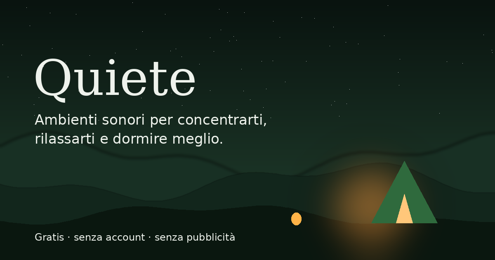

# Quiete

<p align="center">
  
</p>

<p align="center">
  <strong>Trova il tuo spazio di tranquillità.</strong>
  <br>
  Paesaggi sonori generati in tempo reale, da modellare secondo il tuo momento.
</p>

<p align="center">
  <a href="https://giuseppedavino.github.io/quiete/"><strong>Apri Quiete</strong></a>
  &nbsp;·&nbsp;
  <a href="https://github.com/GiuseppeDAvino/quiete">Repository</a>
</p>

---

## Overview

**Quiete** è una web application dedicata alla creazione di ambienti sonori personalizzati.

Nasce dall'idea di trasformare semplici suoni ambientali in esperienze audio personalizzabili, attraverso un'interfaccia essenziale e immersiva.

Pioggia, onde del mare, vento, fuoco e altri paesaggi sonori vengono generati direttamente nel browser, senza utilizzare file audio preregistrati.

Ogni ambiente può essere modificato attraverso un mixer audio integrato, che permette di intervenire sulle singole frequenze e costruire la propria atmosfera sonora.

Nessuna registrazione, nessun abbonamento e nessuna installazione obbligatoria.

## Features

### Ambienti sonori

Nove scenari sonori, ognuno con una propria identità acustica e visiva:

| Ambiente | Descrizione |
|---|---|
| Pioggia | Pioggia intensa e costante |
| Oceano | Onde lente e atmosfere marine |
| Vento | Raffiche e atmosfere naturali |
| Camino | Crepitio del fuoco e brace |
| Temporale | Pioggia e tuoni in lontananza |
| Ciotole armoniche | Composizioni di toni puri |
| Anti-voci | Rumore modellato per mascherare le conversazioni |
| Cabina d'aereo | Ronzio ambientale a bassa frequenza |
| Rumore bianco | Rumore uniforme su tutte le frequenze |

### Audio Mixer

Un mixer integrato per modellare ogni ambiente sonoro:

- Equalizzatore a 10 bande, da 31 Hz a 16 kHz.
- Regolazione indipendente delle singole frequenze.
- Controllo del tono, da scuro a chiaro.
- Regolazione del volume.
- Animazione automatica delle frequenze.
- Generazione casuale di nuove configurazioni.
- Ripristino dei parametri originali.

### Modalità di ascolto

Gli ambienti sono organizzati in diverse categorie:

- **Focus** – Per creare un ambiente sonoro durante lo studio o il lavoro.
- **Relax** – Per accompagnare momenti di tranquillità.
- **Sonno** – Per creare un sottofondo durante il riposo.
- **Mascheramento** – Per coprire parte dei rumori e delle conversazioni circostanti.

### Binaural Audio

Generazione di toni binaurali attraverso oscillatori indipendenti sui due canali stereo.

Sono disponibili cinque frequenze selezionabili:

- Delta – 2 Hz
- Theta – 6 Hz
- Alpha – 10 Hz
- Beta – 18 Hz
- Gamma – 40 Hz

La funzionalità è pensata per l'ascolto tramite cuffie stereo.

### Esperienza personalizzata

- Salvataggio degli ambienti preferiti.
- Memorizzazione delle impostazioni audio.
- Riproduzione casuale.
- Navigazione tra gli ambienti.
- Timer con spegnimento automatico a 15, 30, 60 o 90 minuti.
- Visualizzazione audio dinamica.
- Animazioni ambientali sincronizzate con l'audio.

### Zen Mode

Una modalità a schermo intero progettata per ridurre le distrazioni e lasciare spazio esclusivamente all'esperienza sonora.

Include:
- Interfaccia minimale.
- Controlli essenziali di riproduzione.
- Navigazione tra gli ambienti.
- Supporto allo Screen Wake Lock, quando disponibile.

### Progressive Web App

Quiete può essere installata sui dispositivi compatibili come applicazione indipendente.

Grazie al Service Worker e alla cache locale, l'applicazione può essere utilizzata anche offline dopo il caricamento iniziale.

---

## Technologies

Quiete è sviluppato utilizzando tecnologie web native, senza framework o dipendenze esterne.

| Tecnologia | Utilizzo |
|---|---|
| HTML5 | Struttura dell'applicazione |
| CSS3 | Interfaccia, animazioni e responsive design |
| JavaScript | Logica applicativa e gestione delle interazioni |
| Web Audio API | Generazione e manipolazione audio |
| Canvas API | Visualizzazioni e animazioni dinamiche |
| SVG | Scenari e grafiche ambientali |
| LocalStorage | Preferiti e configurazioni personalizzate |
| Service Worker | Cache e supporto offline |
| Web App Manifest | Installazione come PWA |

## Architecture

L'applicazione segue un'architettura client-side.

La generazione audio, la gestione del mixer e il rendering delle animazioni avvengono direttamente nel browser.

Non sono necessari:
- Backend.
- Database.
- API esterne.
- Librerie o framework JavaScript.
- File audio preregistrati.

## Getting Started

### Requirements

- Un browser moderno con supporto a JavaScript e Web Audio API.
- Python 3 oppure un altro server HTTP locale.

### Installation

Clona il repository:

```bash
git clone https://github.com/GiuseppeDAvino/quiete.git
```

Entra nella directory:

```bash
cd quiete
```

Avvia un server HTTP locale:

```bash
python -m http.server 8000
```

Apri il browser all'indirizzo:

```text
http://localhost:8000
```

Non è necessario installare pacchetti o eseguire processi di build.

## Privacy

La privacy è uno dei principi alla base del progetto.

Quiete è progettato per funzionare direttamente sul dispositivo dell'utente.

- Nessuna registrazione o autenticazione.
- Nessun backend o database.
- Nessun servizio esterno necessario per la generazione audio.
- Preferiti e configurazioni memorizzati localmente.
- Nessun cookie di tracciamento o pubblicità.

L'elaborazione audio avviene attraverso le API native del browser.

Per maggiori informazioni consulta [Privacy Policy](privacy.html).

## Compatibility

Quiete è progettato per funzionare sui browser moderni desktop e mobile.

L'installazione PWA e alcune funzionalità, come lo Screen Wake Lock, dipendono dal supporto del browser e del dispositivo.

**Nota:** per ragioni di sicurezza dei browser, la riproduzione audio deve essere avviata attraverso un'interazione dell'utente. Su iPhone e iPad è necessario un tocco per avviare l'audio.

---

<p align="center">
  <strong>Quiete</strong>
  <br>
  Un piccolo spazio per ritrovare la tranquillità.
  <br><br>
  Developed by <a href="https://github.com/GiuseppeDAvino">Giuseppe D'Avino</a>
</p>
